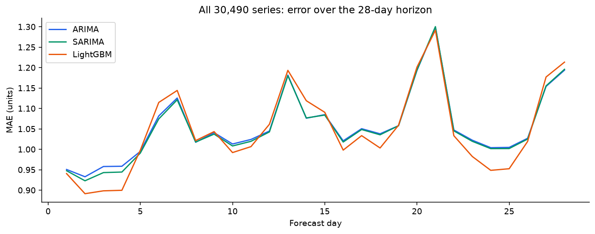
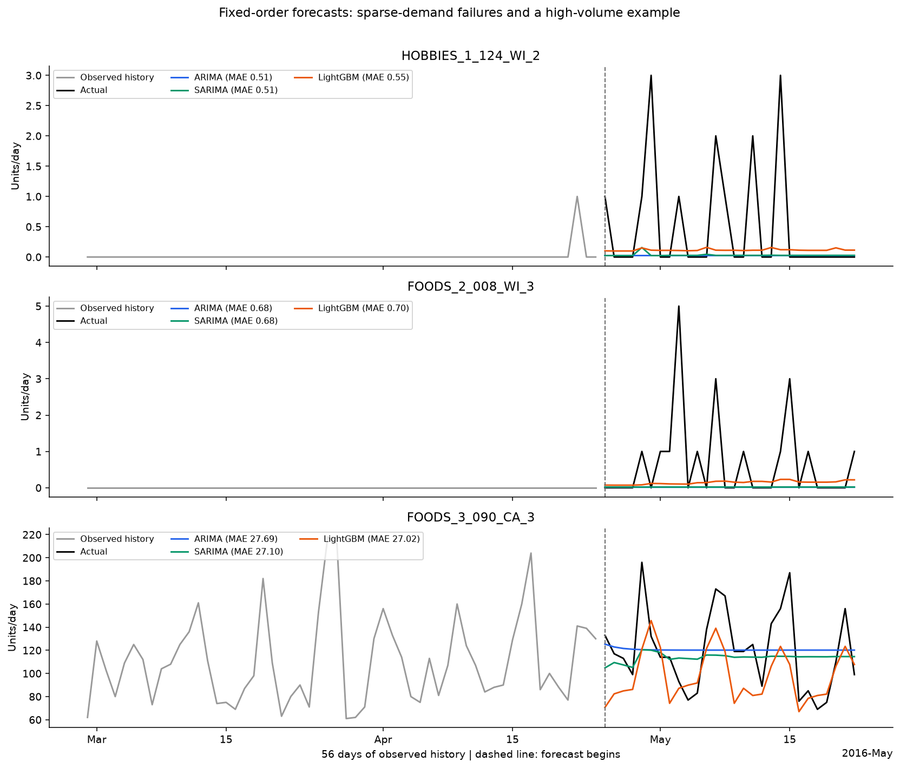

# Retail Sales Forecasting: ARIMA, SARIMA, and LightGBM

A retail time series study using M5 sales data to compare statistical forecasting
with machine learning over a 28-day horizon.

## Model summary

| Model | Specification | Approach |
| --- | --- | --- |
| ARIMA | ARIMA(1,1,1) | Models each series without an explicit seasonal component. |
| SARIMA | SARIMA(1,1,1)(1,0,0,7) | Adds a weekly seasonal component to each series. |
| LightGBM | 200 trees, 31 leaves, learning rate 0.05 | Uses calendar and lag features to correct a recent weekday-average forecast. |

ARIMA and SARIMA fit each series separately; LightGBM learns across related series.

## Evaluation

The three models forecast the same **90 product/store series** for **28 days**,
balanced across stores, categories, and training-volume bands. Two development
windows precede the local test, **2016-04-25 to 2016-05-22**. The local test was
previously inspected, so this is a retrospective comparison. RMSSE is averaged
equally across the sampled series. All 540/540 statistical fits converged.

| Model | Development RMSSE | Local-test RMSSE | Local-test MAE | Local-test RMSE |
| --- | --- | --- | --- | --- |
| SARIMA | 0.7213 | 0.6865 | 0.9504 | 1.7022 |
| ARIMA | 0.7225 | 0.6868 | 0.9511 | 1.7012 |
| LightGBM | 0.7276 | 0.6959 | 0.9390 | 1.7125 |

## Comparison graphs

### Model scores

### Error across the forecast horizon

### Representative forecasts

Examples from low-, medium-, and high-volume series selected using training data.

## Final comparison

**SARIMA** has the lowest mean RMSSE, **LightGBM** the lowest MAE,
and **ARIMA** the lowest RMSE. The differences are small, particularly
between ARIMA and SARIMA. These results describe this matched sample with
fixed model settings.
