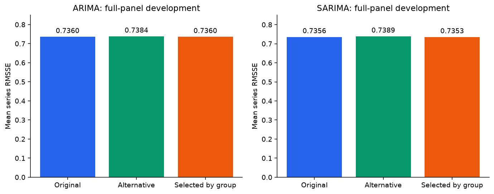
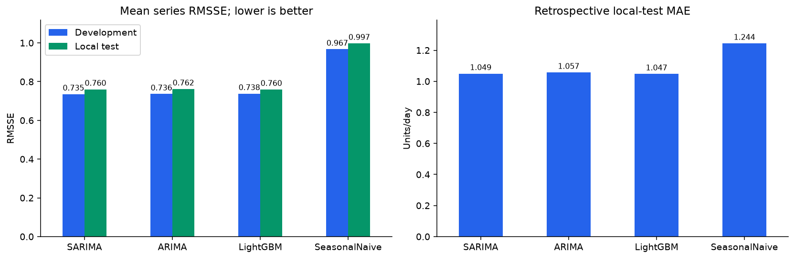
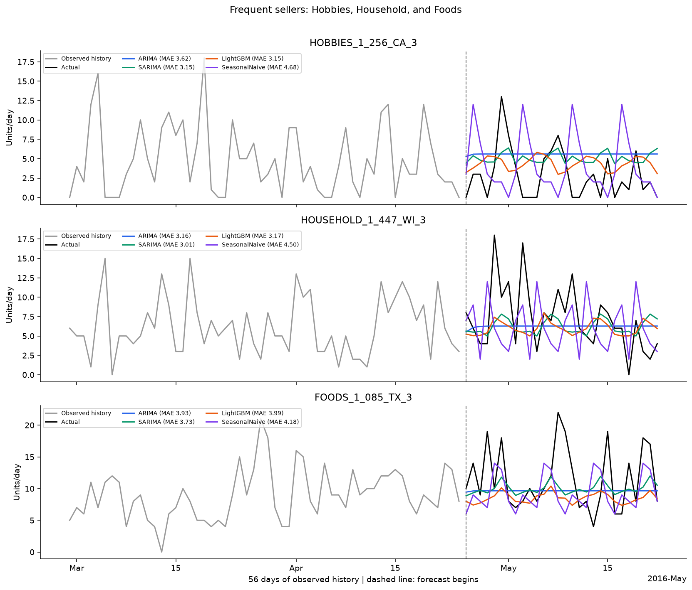

# Retail Sales Forecasting: ARIMA, SARIMA, and LightGBM

A retail time series study using M5 sales data to compare development-tuned statistical forecasting
with machine learning and a weekly seasonal-naive baseline over a 28-day horizon.

## Model summary

| Model | Demand group | Selected setting |
| --- | --- | --- |
| ARIMA | intermittent | (1, 1, 1); 728 days; trend=n |
| ARIMA | regular | (1, 1, 1); 728 days; trend=n |
| SARIMA | intermittent | (1, 1, 1)(1, 0, 0, 7); 728 days; trend=n |
| SARIMA | regular | (0, 1, 1)(0, 1, 1, 7); 728 days; trend=n |
| LightGBM | All | Pooled; 200 trees, 31 leaves, learning rate 0.05 |
| SeasonalNaive | All | Repeat the last seven observed sales values |

All methods forecast every series. Statistical fits are local; LightGBM pools calendar and lag features to correct an eight-week weekday mean.

## Development-only tuning

Ten settings vary orders, weekly differencing, and 364/728-day histories.
Screening uses 536 stratified series weighted to the full population.
Each family's strongest alternative is confirmed against its original setting
on all 30,490 series in two development windows. Lower mean RMSSE selects settings
separately for regular and intermittent demand, using groups fixed before development.
Groups use 90 days before the first development window; regular sellers have
sales on at least 80% of those days.
Alternative SARIMA uses conditional fitting after differencing, with forecasts
restored to sales units. The local test never selects settings.

## Evaluation

Three models and a weekly baseline forecast **30,490 product/store series** for **28 days**.
Two development windows precede the local test, **2016-04-25 to 2016-05-22**.
The previously inspected local test makes this a retrospective comparison.
MAE/RMSE cover every series; equal-weight mean RMSSE covers 30,490 series with defined training scales.
182,669/182,760 optimized statistical fits converged;
180 constant-history windows receive exact constant forecasts.

| Model | Development RMSSE | Local-test RMSSE | Local-test MAE | Local-test RMSE |
| --- | --- | --- | --- | --- |
| SARIMA | 0.7353 | 0.7604 | 1.0491 | 2.1993 |
| ARIMA | 0.7360 | 0.7617 | 1.0570 | 2.2181 |
| LightGBM | 0.7377 | 0.7595 | 1.0473 | 2.1532 |
| SeasonalNaive | 0.9671 | 0.9972 | 1.2440 | 2.6769 |

## Comparison graphs

### Model scores

### Error across the forecast horizon

### Frequent-seller forecasts

897 product/store series sold on at least 95% of the 90 days before
the first development window. The examples are the median-volume eligible series
within each category, selected without forecast-period outcomes. All models
forecast these products. Grey lines show 56 days of observed history.

### Sparse-demand and high-volume failure cases

The earlier low-, median-, and high-volume examples remain below.
HOBBIES_1_124_WI_2 had one sale in 728 training days; FOODS_2_008_WI_3 had no sales
in its last 56 training days. Their later recovery remains difficult to predict.
Zero sales alone cannot establish the reason. The same examples are retained across model comparisons.

## Final comparison

**LightGBM** leads local-test mean RMSSE, MAE, and RMSE. Its mean RMSSE is 23.8% below the weekly baseline.
**SARIMA** has the lowest average development RMSSE.
All scores cover 30,490 series and common windows. Tuning is a limited search;
individual forecasts still miss spikes and changing demand. The previously
inspected local test supports a retrospective comparison.

ARIMA retained its original settings; its local-test score is unchanged. SARIMA local-test mean RMSSE is 0.13% lower than its original setting.
