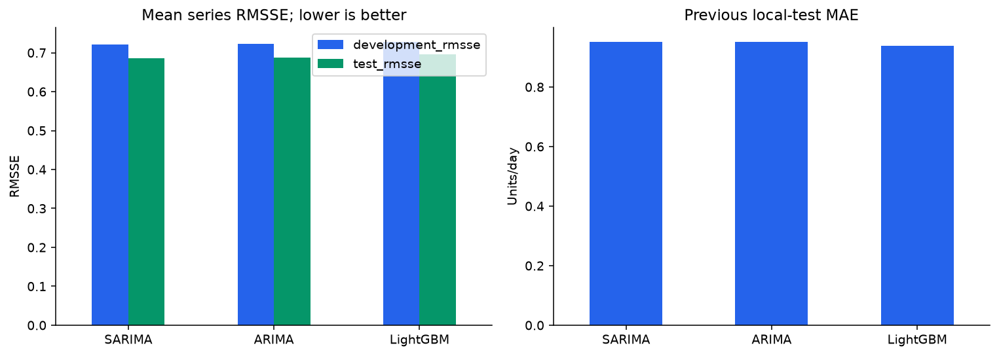

# Retail Sales Forecasting: ARIMA, SARIMA, and LightGBM

An M5 time series project with complete sales/calendar/price EDA and a matched
comparison of three forecasting models. Code lives in short, focused notebook
cells; no project Python modules are imported.

## Current comparison

The same **90 varying-demand series**, stratified across 10 stores, 3 categories,
and training-volume bands, are forecast for 28 days. Sampling uses only data
before the earliest comparison window. Two development windows and a previously
inspected local test are used; the local test is a retrospective benchmark.

| Model | Development mean RMSSE | Local-test mean RMSSE | Test MAE | Test RMSE |
| --- | --- | --- | --- | --- |
| SARIMA | 0.7213 | 0.6865 | 0.9504 | 1.7022 |
| ARIMA | 0.7225 | 0.6868 | 0.9511 | 1.7012 |
| LightGBM | 0.7276 | 0.6959 | 0.9390 | 1.7125 |

SARIMA has the lowest mean RMSSE, LightGBM the lowest MAE, and ARIMA the lowest
RMSE on this sample. These are close results, not proof of population-wide
superiority. Mean RMSSE here is equally weighted over 90 series; it is **not**
the full M5 hierarchical WRMSSE score.

Read the [short final report](reports/final_comparison.md).



## Run the notebooks in order

1. [EDA](notebooks/eda/01_data_exploration.ipynb): all five sources, trends,
   weekly seasonality, sparse demand, stores/categories, events, SNAP, and prices.
2. [Preprocessing](notebooks/preprocessing/02_preprocessing.ipynb): validate and
   align histories, save compact arrays, test leakage, and select 90 series.
3. [Modeling](notebooks/modeling/03_model_comparison.ipynb): fit ARIMA(1,1,1),
   weekly SARIMA(1,1,1)(1,0,0,7), and pooled LightGBM on the same forecast windows.
4. [Evaluation](notebooks/evaluation/04_error_analysis.ipynb): recalculate metrics,
   inspect convergence, plot errors/forecasts, and write one short final report.

ARIMA and SARIMA use 728 recent observations per series. LightGBM pools all
30,490 series, uses 728 days of target dates with earlier feature warm-up history,
known calendar variables, and a correction to an origin-available eight-week
weekday baseline. Its 13-day training sampling rotates weekdays. This compares
local statistical models with a pooled feature-based model, not identical model
information structures. Orders/settings are fixed, not exhaustively tuned.

## Setup

```bash
python3.11 -m venv .venv
source .venv/bin/activate
python -m pip install -r requirements-lock.txt
python -m ipykernel install --sys-prefix --name m5-forecasting --display-name "Python 3.11 (M5 Forecasting)"
jupyter lab
```

Select **Python 3.11 (M5 Forecasting)**. The five original M5 CSVs belong directly
in `data/`; obtain them from the [M5 resources](https://github.com/Mcompetitions/M5-methods).
Sales histories overlap and are aligned, not concatenated. Zero sales are
retained. Event/price relationships are descriptive, not causal.

On this Mac, LightGBM uses a build without OpenMP. If the wheel cannot find
`libomp`, reproduce that build inside the environment:

```bash
python -m pip install --no-binary=lightgbm --no-deps --force-reinstall --config-settings=cmake.define.USE_OPENMP=OFF lightgbm==4.7.0
```

## Outputs

- `configs/comparison.json`: the current fixed comparison settings.
- `data/processed/`: aligned arrays, metadata, and `comparison_sample.csv`.
- `data/interim/three_model_*.npy`: matched-sample forecasts.
- `models/comparison_lightgbm_*.joblib`: fitted pooled models.
- `reports/results/three_model_*.csv`: scores, comparisons, and convergence details.
- `reports/results/three_model_manifest.json`: sample IDs, settings, versions, and input fingerprints.
- `reports/figures/comparison_*.png`: comparison charts.
- `reports/final_comparison.md`: the single short report for this comparison.

Earlier full-panel LightGBM results, reports, and the 60,980-row forecast export
are retained as prior work. They are separate from this 90-series benchmark.
Large data, models, and the environment are excluded from Git. No inventory
savings or fresh external-test performance have been measured.
